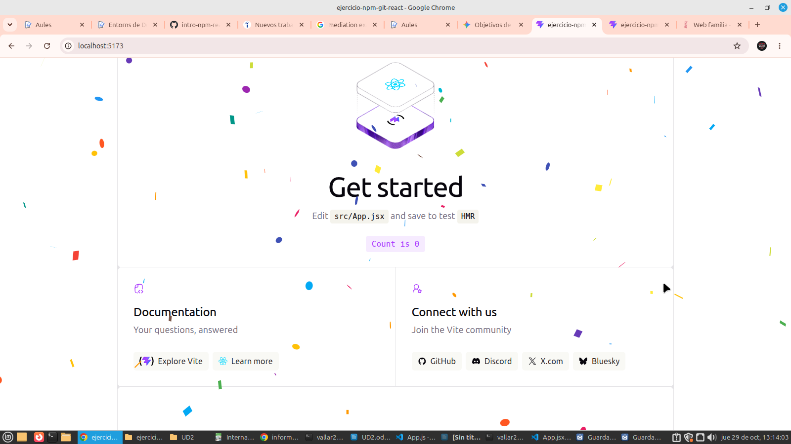
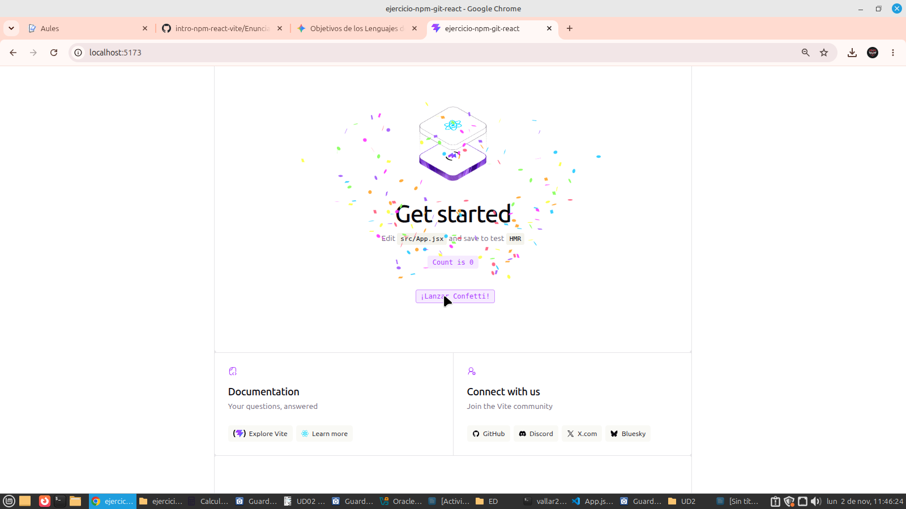
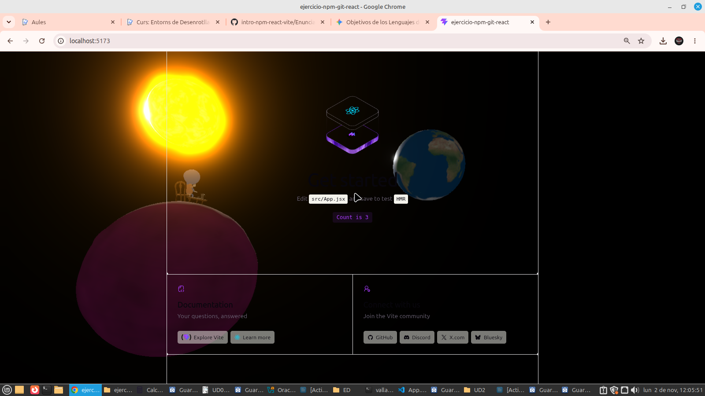

# Práctica: Ejercicio NPM, Git y React

## Capturas de la práctica
- **React Confetti:**
  

- **Canvas Confetti:**
  

- **Escena 3D:**
  

## Pregunta teórica
**Si la carpeta `node_modules/` está excluida, ¿borrar una dependencia hace alguna acción sobre el repositorio? ¿Cuál?**
No, borrar una dependencia localmente o no incluir el `node_modules` no afecta al servidor de GitHub porque la carpeta está ignorada en el `.gitignore`. Al clonar el repositorio, la carpeta se regenera ejecutando `npm install`, que lee el `package.json` para descargar los paquetes de nuevo.

## Enlace a la web desplegada
https://vall23166-sys.github.io/ejercicio-npm-git-react-deploy/
